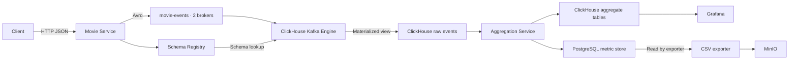

# HW5 · Online Cinema Analytics

Movie Service accepts viewing events over HTTP and publishes Avro records to Kafka. ClickHouse ingests the topic through a Kafka Engine table and materialized view. A separate service builds daily metrics in ClickHouse for Grafana and writes them to PostgreSQL for CSV export to MinIO.



## Quick start on Windows

Use Docker Desktop with Linux containers and Docker Compose v2. Run from the checkout root. Python 3.11+ is needed only to run the optional verification scripts from PowerShell. Compose includes local demo credentials, so you can start without an `.env` file.

```powershell
docker compose up --build
```

For a clean start, `docker compose down -v` removes persisted Kafka, database, Grafana, and MinIO data. Run `docker compose up --build` again to initialize everything from scratch.

Run these checks in a second PowerShell terminal.

```powershell
docker compose ps -a
py scripts/integration_test.py
py scripts/metrics_demo.py
py scripts/grafana_demo.py
py scripts/export_demo.py
py scripts/kafka_failover_demo.py
```

`py scripts/demo.py --failover` runs the complete verification sequence, including schema and topic inspection. On platforms without the Windows launcher, use `python` in place of `py`. The scripts use Python’s standard library and Docker Compose.

| Service | Local address or internal port |
| --- | --- |
| Movie Service API and Swagger | http://localhost:8000/docs |
| Aggregation Service API and Swagger | http://localhost:8001/docs |
| Schema Registry | http://localhost:8081/subjects |
| ClickHouse HTTP | http://localhost:8123/ping |
| Grafana · Cinema Analytics | http://localhost:3000/d/cinema-analytics |
| MinIO S3 API | http://localhost:9000 |
| MinIO web console | http://localhost:9001 |
| PostgreSQL | `postgres:5432` inside Compose |
| Kafka brokers | `kafka-1:29092`, `kafka-2:29092` inside Compose |
| KRaft controller listeners | `kafka-1:29093`, `kafka-2:29093`, `kafka-controller:29093` inside Compose |

Local demo credentials only. Grafana uses `admin` / `cinema_demo`, ClickHouse and PostgreSQL use `cinema` / `cinema_demo`, and MinIO uses `cinema-demo` / `cinema-demo-password`. Copy `.env.example` to `.env` to override settings before the first start. PostgreSQL and Grafana initialize credentials on fresh volumes.

## Send events and view results

```powershell
$event = @{
    user_id = "viewer-42"
    movie_id = "orbit"
    event_type = "VIEW_STARTED"
    timestamp = [DateTimeOffset]::UtcNow.ToString("o")
    device_type = "TV"
    session_id = [guid]::NewGuid().ToString()
    progress_seconds = 0
}
Invoke-RestMethod -Method Post -Uri http://localhost:8000/events -ContentType 'application/json' -Body ($event | ConvertTo-Json)
```

Supply `event_id` in the initial request if you need to retry after a timeout. The published record uses the `MovieEvent` Avro schema with the subject `movie-events-value`. The Kafka key is `user_id`, so events for a user go to the same partition with the configured partition count. Kafka orders offsets within each partition. The topic has no global ordering.

Run `py scripts/metrics_demo.py` to seed 178 events from April 1 through April 9, 2026 and materialize every date. The dashboard opens on that UTC range. Cohort Day 0–7 uses a colored table. Four other panels show DAU, view conversion, average completed watch time, and top movies. Change the Grafana time range to inspect other dates.

```powershell
Invoke-RestMethod -Method Post -Uri http://localhost:8000/generator/demo
Invoke-RestMethod -Method Post -Uri http://localhost:8001/aggregate/2026-04-01
Invoke-RestMethod -Method Post -Uri http://localhost:8001/export/2026-04-01
```

The seed endpoint returns after publication. ClickHouse ingests asynchronously. The metrics script polls for all seed events before calculating. The scheduler also recalculates known dates every 60 seconds by default. It exports completed dates after the configured UTC hour. Find the object at `s3://movie-analytics/daily/2026-04-01/aggregates.csv`. A repeated export overwrites that key.

For April 1 the seed yields DAU **10**, average watch time **4,200 seconds**, conversion **90%**, top movie **orbit** with **6** completions, **50%** Day 1 retention, and **30%** Day 7 retention.

## Generate continuous traffic

`/generator/start` runs ongoing synthetic traffic at up to two events per second. It uses current UTC timestamps, cycles through users, movies, and devices, and simulates searches and viewing sessions. Playback progress is accelerated for the demo.

```powershell
Invoke-RestMethod -Method Post http://localhost:8000/generator/start
Invoke-RestMethod http://localhost:8000/generator/status
Invoke-RestMethod -Method Post http://localhost:8000/generator/stop
```

All three endpoints return `running` and `events_published`. The count includes acknowledged background events since Movie Service started. Repeating start keeps the same worker. Stop waits for the current publication and may leave the current session incomplete. Repeating stop returns the stopped status.

Use `/generator/demo` for the deterministic historical seed that powers the retention and business metrics checks. Select today's UTC date in Grafana to see aggregates from the continuous generator after the next scheduler run.

## Inspect the running stack

```powershell
$schema = Invoke-RestMethod http://localhost:8081/subjects/movie-events-value/versions/latest
$schema | Select-Object subject, version, id
$schema.schema | ConvertFrom-Json
docker compose exec kafka-1 kafka-topics --bootstrap-server kafka-1:29092 --describe --topic movie-events
docker compose exec kafka-1 kafka-metadata-quorum --bootstrap-server kafka-1:29092 describe --status
docker compose exec clickhouse clickhouse-client --user cinema --password cinema_demo --database cinema --query "SHOW TABLES"
docker compose exec postgres psql -U cinema -d cinema -c "SELECT * FROM daily_metrics WHERE metric_date = '2026-04-01' ORDER BY metric_name, dimension_value"
docker compose run --rm --no-deps minio-init ls local/movie-analytics/daily/2026-04-01/
docker compose logs --tail 50 movie-service aggregation-service
```

The topic has three partitions, replication factor 2, and `min.insync.replicas=1`. Both brokers also vote in the three-node KRaft quorum, so the surviving broker and the controller-only node can elect leaders after either broker stops. Producers use `acks=all`. A write acknowledged by a single in-sync replica has weaker durability than one acknowledged by two. The failover script waits for leader election, checks real ingestion while broker 1 is down, restores the broker in `finally`, and waits for two replicas in ISR again.

Run the unit tests using the application images.

```powershell
docker compose run --rm --no-deps movie-service python -m pytest -q
docker compose run --rm --no-deps aggregation-service python -m pytest -q
```

## Troubleshooting

- Allow the first startup to finish. `docker compose ps -a` should show healthy services and exit code 0 for `kafka-init` and `minio-init`. On failure, check `docker compose logs <service>`.
- If startup reports a published port in use, free that port before running the defense scripts. The scripts target the ports in the table.
- If the dashboard is empty, run the metrics demo and select April 1–9, 2026 in UTC. If a panel reports a datasource error, inspect `docker compose logs grafana clickhouse`.
- If ingestion fails, check the `movie-events-value` subject, topic ISR, and `docker compose logs clickhouse movie-service`. Retry an ambiguous publication with the original event ID.
- When changing init SQL, recreate the corresponding demo volumes to apply the new schema. Compose runs the database init SQL on empty volumes.

See [architecture](docs/architecture.md), [event schema](docs/event_schema.md), [metric definitions](docs/metrics.md), and [verification results](docs/verification.md).
